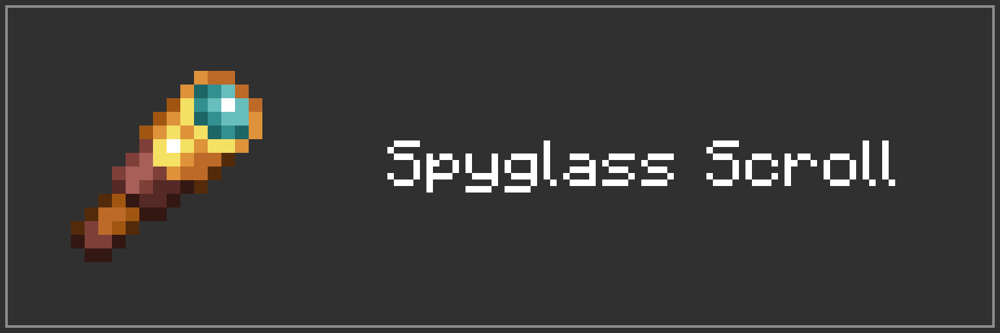
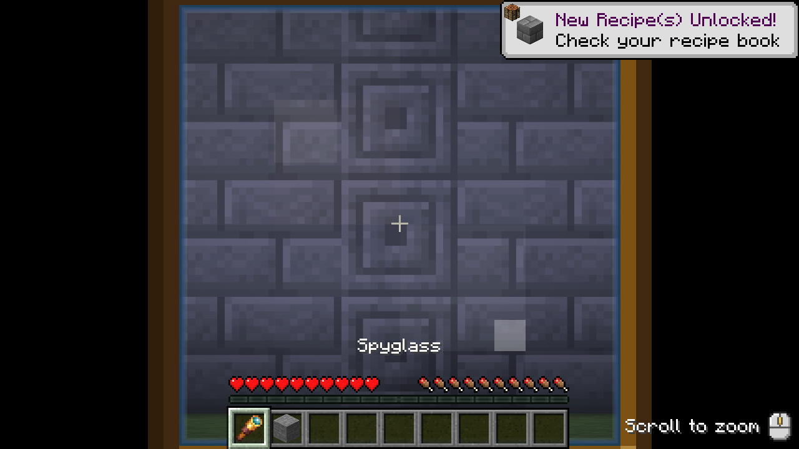

# Spyglass Scroll

Scroll to zoom while using a spyglass. Works in either hand, with no server mod required.

[](https://youtu.be/8tlVviQIKaw)

[Watch the demo on YouTube](https://youtu.be/8tlVviQIKaw).

Scroll up to zoom in and down to zoom out. Each step changes magnification by 1.25×, from 2× to 50×. Every use starts at the vanilla 10× zoom. Mouse sensitivity follows magnification; vanilla transitions and scroll sensitivity are preserved.

## Installation

Supports Minecraft 1.21.11, 26.1, 26.1.1, 26.1.2, 26.2, and 26.3. Requires Fabric Loader 0.19.5 or newer and Fabric API.
Download the jar matching your Minecraft version from [Releases](https://github.com/PluginsKers/spyglass-scroll/releases) and place it in your client's `mods` folder. Use Java 21 for 1.21.11 and Java 25 for 26.x.

## Building

```sh
./gradlew assemble
```

Use `gradlew.bat` on Windows. Run Gradle with JDK 25; the Java 21 toolchain is downloaded when needed. `assemble` builds all versions; `:1.21.11:assemble` builds one. Jars are written to `versions/<minecraft>/build/libs`.

## License

[MIT](LICENSE).

The logo and banner use Minecraft artwork by Mojang Studios.
